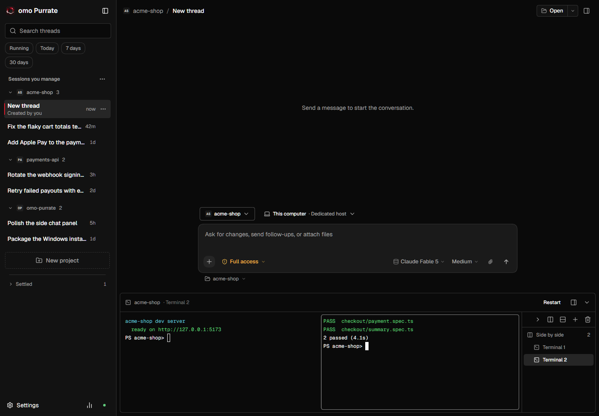
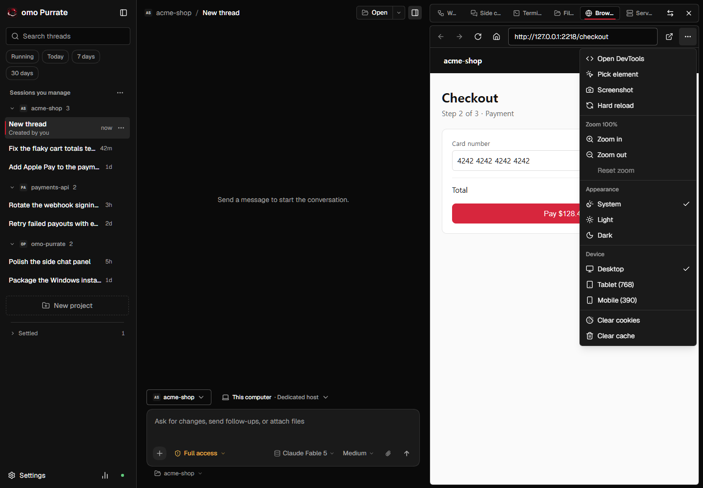
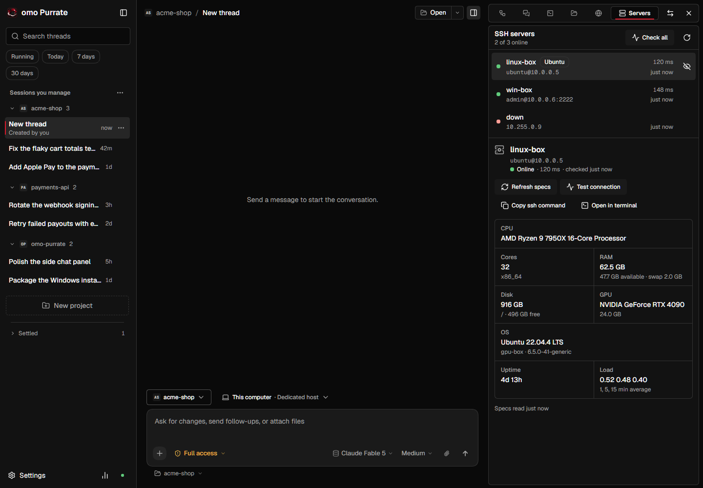
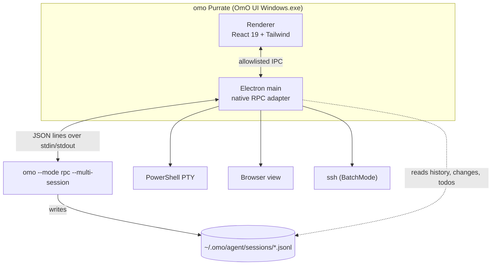

<p align="center">
  
</p>

<h1 align="center">omo Purrate</h1>

<p align="center">
  <b>A pirate cat's Windows desktop for <a href="https://get.omo.dev">omo</a>, the coding agent.</b><br>
  Sessions you actually started, agents you can watch, a real terminal, a browser and your SSH fleet, all in one window.
</p>

<p align="center">
  
  
  
  
  
</p>

<p align="center">
  <a href="#install">Install</a> ·
  <a href="#feature-tour">Feature tour</a> ·
  <a href="#keyboard-shortcuts">Shortcuts</a> ·
  <a href="#how-it-works">How it works</a> ·
  <a href="#development">Development</a>
</p>

<p align="center">
  <a href="docs/media/promo.mp4"></a><br>
  <sub>Click for the full-quality video.</sub>
</p>

omo Purrate is a fan-made Windows desktop for omo. It runs the omo you already have, with the same sessions, skills, models and credentials as omo in your terminal, and adds what a terminal can't show at a glance: which agents are running, what they changed, and the tools around your project.

It is an independent project by [purrbeard](https://github.com/purrbeard), not an official omo release. See [Credits](#credits) for where it came from.

```powershell
irm https://raw.githubusercontent.com/purrbeard/omo-purrate/main/scripts/install.ps1 | iex
```

## Highlights

- **Only your sessions, from the first launch.** Every session the app starts is stamped as yours. The first-run import pre-selects only sessions a person started (in the app or typed in the terminal) and leaves out empty, damaged, automation and temp sessions. It never adds a project you did not pick.
- **Watch the agents work.** DAG runs drawn as wave lanes, child tasks, an agent tab for each subagent, todos and the session goal, live while omo works.
- **See what changed.** Each session's file changes and diffs come from omo's own session file, so they show up even outside a git repository.
- **A real terminal.** PowerShell in a real PTY, split side by side or stacked, docked at the bottom or on the side, with a list of every shell.
- **A browser beside the chat.** Open your dev server, switch to a tablet or phone width, zoom, take a screenshot, or pick an element into the composer.
- **Your SSH servers.** Hosts from `~/.ssh/config` with online status, latency and specs (CPU, RAM, GPU, disk, OS), and one click to open a session in the terminal.
- **Ask on the side with `/btw`.** A side chat answers from the session's context and never touches the session.
- **Context compaction you can see.** When omo compacts the context, a card shows why, how many tokens it saved and the summary it kept.
- **Skills on `/`**, inline approvals and questions, edit and regenerate, account quotas, light and dark, English and Korean.

## Feature tour

Every image below is the real interface, captured from the built app by `npm run screenshots` against scripted demo sessions played by the repository's fake omo. None of them shows a real person's sessions or machines.

<picture>
  <source media="(prefers-color-scheme: dark)" srcset="docs/media/hero-dark.png">
  
</picture>

### Watch the agents work

When omo fans work out, for example with mass-ulw, the **Activity** chip in the header counts running work. Open it to see each DAG run with its waves and node states, the live activity of running nodes, and every child task with its agent, model, progress and result. The todo list, the goal and running background work sit in one line above the composer.

<p align="center">
  
  
</p>
<p align="center">
  
</p>

### A terminal that is really a terminal

Press Ctrl+\` for PowerShell in a real PTY (pwsh, then Windows PowerShell, then cmd), with colors, prompts like `Read-Host`, UTF-8 and resizing. Split side by side or stacked, keep several groups, and dock the panel at the bottom or on the side. Each session keeps its own shells.

<p align="center">
  
</p>

### A browser and site tools in the side dock

The **Browser** tab opens pages next to the conversation, starting from the local servers it finds on this PC. Its tools menu opens DevTools, picks an element into the composer, takes screenshots, zooms, forces light or dark, switches to tablet or phone width, and clears cookies or cache.

<p align="center">
  
</p>

### Your SSH servers, at a glance

The **Servers** tab reads the hosts in `~/.ssh/config` (it never edits the file) and checks them without prompting for anything. Each host shows whether it is online, its latency and OS; select one to read its CPU, cores, RAM, disk, GPU, uptime and load, copy its ssh command, or open it in a new terminal.

<p align="center">
  
</p>

### Skills, one keystroke away

Type `/` at the start of the message or after a space. The menu lists the skills omo can load for the session's workspace, with their scope and description, plus `/btw`. Up to five skills go into one message, and the sent message shows each as a chip.

<p align="center">
  
</p>
<p align="center">
  
</p>

### Ask on the side with `/btw`

Type `/btw <question>`, press Ctrl+E, or click **Side chat**. The answer streams into a panel beside the conversation while the main turn keeps running. Each side chat is its own omo session that receives the recent conversation as read-only background; nothing is added to the main transcript.

<p align="center">
  
</p>

### Approvals and questions, inline

When omo needs permission, the card shows the command, the working directory and the reason. Allow it once, for the session, or deny it with a reason; with the card focused, Enter allows once and Escape denies. Questions arrive as cards with their options and, when omo allows it, a free-text answer.

<p align="center">
  
</p>
<p align="center">
  
</p>

### Answers that read like documentation

Answers stream as Markdown with headings, tables, inline code and highlighted code blocks; reasoning, searches, file edits and commands appear as compact tool cards in the order omo ran them.

<p align="center">
  
</p>

### First run installs omo

If omo is missing, the first screen offers the official installer, or the command to paste into a terminal, and reconnects on its own afterwards.

<p align="center">
  
</p>

### 한국어

Every label in the window is available in Korean. Choose the language in Settings, or follow the system language.

<p align="center">
  
</p>

### On the real omo

The installed app on the real omo, answering with DeepSeek v4.1 Flash in a throwaway sample project.

<p align="center">
  
</p>

## Install

Requirements: Windows 10 or 11, x64. Run the commands from a normal PowerShell window, not one opened as Administrator: the official omo installer refuses to run elevated.

### One-line install (omo + app)

```powershell
irm https://raw.githubusercontent.com/purrbeard/omo-purrate/main/scripts/install.ps1 | iex
```

The script, [scripts/install.ps1](scripts/install.ps1):

1. Looks for omo the way the app does (`~/.omo/install.json`, `~/.local/bin/omo.exe`, then PATH). If omo is missing, it runs the official installer (`irm https://get.omo.dev/install.ps1 | iex`).
2. Finds the newest release of [purrbeard/omo-purrate](https://github.com/purrbeard/omo-purrate/releases) with a Windows installer (prereleases included).
3. Downloads `OmO UI Windows Setup <version>.exe` and checks its SHA-256 against GitHub's asset digest or the release's `SHA256SUMS`.
4. Installs it silently for the current user into `%LOCALAPPDATA%\Programs\OmO UI Windows` (no administrator rights; Start menu and desktop shortcuts are created) and opens the app.

The installer and install folder keep the name `OmO UI Windows` so existing installs upgrade in place; the app itself shows as **omo Purrate**. The script stops without changing anything if the app is running. Running it again upgrades to the newest release and keeps your preferences and omo's sessions. Options, set before running the command:

| Variable | Effect |
| --- | --- |
| `$env:OMO_UI_VERSION = '0.1.4-win.24'` | Install that release instead of the newest one. |
| `$env:OMO_UI_SKIP_OMO = '1'` | Never install omo; the app's first screen can still install it. |
| `$env:OMO_UI_NO_LAUNCH = '1'` | Do not open the app after installing. |

### From the release page

Download `OmO.UI.Windows.Setup.<version>.exe` from [Releases](https://github.com/purrbeard/omo-purrate/releases) and run it. The installer has no publisher certificate, so SmartScreen may show "Windows protected your PC"; choose **More info** > **Run anyway**.

### Updates and uninstall

Settings > About > Windows app update checks this repository's releases (prereleases included) and installs a newer one after verifying its SHA-256; checking never installs on its own. omo itself is updated separately at app launch with the official installer, limited to 20 seconds for the check and 120 seconds for the install; failures leave the app usable with a notice in Settings > omo.

Uninstall from Windows Settings > Apps > Installed apps > **omo Purrate**; omo's `~/.omo` directory (sessions, configuration and credentials) is left in place.

## Keyboard shortcuts

| Keys | Action |
| --- | --- |
| Ctrl+N | New thread |
| Ctrl+O | Open a project (pick a folder, then start in it) |
| Ctrl+K or Ctrl+Shift+P | Command palette |
| Ctrl+1 … Ctrl+9 | Jump to a session in the sidebar |
| Ctrl+E | Show or hide the side dock |
| Ctrl+Shift+E | Show or hide the workspace files panel |
| Ctrl+\\ | Show or hide the sidebar |
| Ctrl+\` | Show or hide the terminal |
| Ctrl+Shift+M | Model picker |
| Ctrl+, | Settings |
| Ctrl+/ | Keyboard shortcuts |
| `/` | Skills and commands menu: ↑ ↓ to move, Enter or Tab to insert, Esc to close |
| Enter / Shift+Enter | Send, or steer the running turn / new line |
| Enter / Esc on an approval card | Allow once / deny |

## Using omo Purrate

- **Sessions you manage**: the sidebar lists the sessions you started or imported, grouped by project and searchable; the pills keep only running sessions or those updated today or in the last 7 or 30 days. **Load more native sessions** brings in more from omo's session store, newest first.
- **New project**: **New project** opens a folder picker and starts the first thread there; a project's **New thread** button starts one right away in that project.
- **Conversation**: answers stream as they are written; reasoning, tool calls and their results appear as cards, and a context compaction shows as its own card with the reason, the token change and the kept summary.
- **Side dock**: Ctrl+E opens the dock beside the conversation with the Workflow, Side chat, Terminal, Files, Browser and Servers tabs. The agent tabs scroll with the wheel or arrow buttons, and an **All agents** menu jumps to any of them.
- **Restored sessions**: a session opened from the sidebar shows its last todo list, its child tasks and its file changes from the session file, tagged **restored**.
- **Stop and steering**: Stop interrupts the running turn. Sending a message while a turn runs steers it; a `/btw` message goes to the side chat instead.
- **Edit and regenerate**: edit an earlier message or regenerate the last answer; each opens a new session titled "… (edited)" and keeps the original unchanged.
- **Accounts and quota**: Settings > Accounts lists the subscription accounts in omo's `auth.json` with their usage windows and reset times. Tokens are read in the main process and never reach the window. **Add account** runs omo's own sign-in in a PowerShell window.
- **Models and profiles**: the model picker switches models for the next turns; Settings > Models edits omo's agent and category routes in your `~/.omo/omo.jsonc` or `omo.json`, keeping a `.models.bak` backup.
- **MCP**: Settings > MCP lists servers, their status and tools, and imports Claude, Cursor or VS Code configurations into omo's `mcp.json`.
- **opencodex proxy**: Settings > Runtime > opencodex registers an OpenAI-compatible proxy's models in omo's `models.json`; the key stays in the main process.
- **Android**: Settings > Android opens a browser control page on a phone connected with `adb`; no APK is needed.

## How it works



The Electron main process starts `omo --mode rpc --multi-session --session-runtime in-process` as a child process and speaks omo's native RPC over stdin and stdout; an adapter there keeps one protocol for the window. The child inherits your Windows environment, so it sees the same `PATH`, API keys and configuration as omo in a new terminal. The omo binary is found in this order: `OMO_UI_OMO_BIN`, `~/.omo/install.json`, `~/.local/bin/omo.exe`, then `PATH`. Session history, file changes and todos are read from omo's session files under `~/.omo/agent/sessions`; the app's own state (managed sessions, import records) lives in a local SQLite database next to its preferences. Quitting the app stops the omo child.

## Troubleshooting

- **omo not found**: install it with `irm https://get.omo.dev/install.ps1 | iex` from a normal PowerShell window, or use the install button on the first screen. Settings shows the binary in use and where it was found. To force one, launch with `$env:OMO_UI_OMO_BIN = 'C:\path\to\omo.exe'; & "$env:LOCALAPPDATA\Programs\OmO UI Windows\OmO UI Windows.exe"`.
- **The installer refuses to run as Administrator**: open PowerShell normally and run the command again.
- **Works in the terminal but not in the app**: the app sees variables set in Windows (Settings > System > About > Advanced system settings > Environment Variables), not ones set only in a PowerShell profile. Set them there, then reopen the app or use **Restart omo** in Settings.
- **SmartScreen blocks the installer**: choose **More info** > **Run anyway**, or use the one-line install, which verifies the SHA-256 first.
- **A server shows "auth failed"**: the Servers tab never prompts; add the host's key to your ssh agent or `IdentityFile` so `ssh -o BatchMode=yes <host>` works in a terminal.
- **Reset preferences**: quit the app and move `%APPDATA%\OmO UI Windows\preferences.json` aside. omo's own sessions and configuration are not stored there.

## Development

Requires Windows x64 and Node.js 22 or later.

```powershell
npm ci                 # also downloads the Electron binary (postinstall)
npm run dev            # Vite dev server (renderer hot reload) + Electron
npm run typecheck
npm test               # vitest unit tests
npm run test:e2e       # Playwright-Electron against a fake omo
npm run package:win    # build the NSIS installer in release/
npm run package:win:dir   # build only release/win-unpacked
npm run screenshots    # re-capture docs/media from the built app (ffmpeg encodes the GIF)
```

`npm run screenshots` drives the built app against the demo scenes in `scripts/readme-demo.mjs`, played by `tests/fixtures/fake-omo.mjs`; `node scripts/readme-media.mjs --only hero,migrate,workbench,korean,onboarding,gif` re-captures a subset. The workbench scene uses a demo `ssh_config` and `tests/fixtures/fake-ssh.mjs`, so no real host is contacted. The real-omo screenshot comes from `e2e/readme-real-omo.spec.ts`, which drives the installed app with fresh app data and a temporary sample project and spends one short paid turn. The promo video at the top (`docs/media/promo.mp4` and its GIF) was made with [HyperFrames](https://hyperframes.heygen.com) from these same captures.

Pushes to `main` run typecheck, unit and e2e tests on Windows; a version bump there publishes `v<version>` with the installer and `SHA256SUMS`, which the app's update check reads.

## Credits

- omo Purrate started from [realsigridjin/omo-ui-macosapp](https://github.com/realsigridjin/omo-ui-macosapp) 0.1.3, Copyright (c) sigridjineth, MIT License. That code is this repository's first commit; everything after it is developed here. The macOS and iOS source that came with it is kept but not supported.
- Parts of the interface and its design tokens came from [DeepSeek Harness](https://github.com/deepseek-ai/deepseek-harness), Copyright (c) 2026 DeepSeek, MIT License. See [NOTICE](NOTICE).
- The Geist and Geist Mono fonts are licensed under the SIL Open Font License 1.1.
- The side chat's layout follows a study of the [Aside](https://aside.com) browser's side panel; no Aside code, artwork or fonts are included.
- The pirate cat icon was made for this project.

## License

MIT. See [LICENSE](LICENSE).
